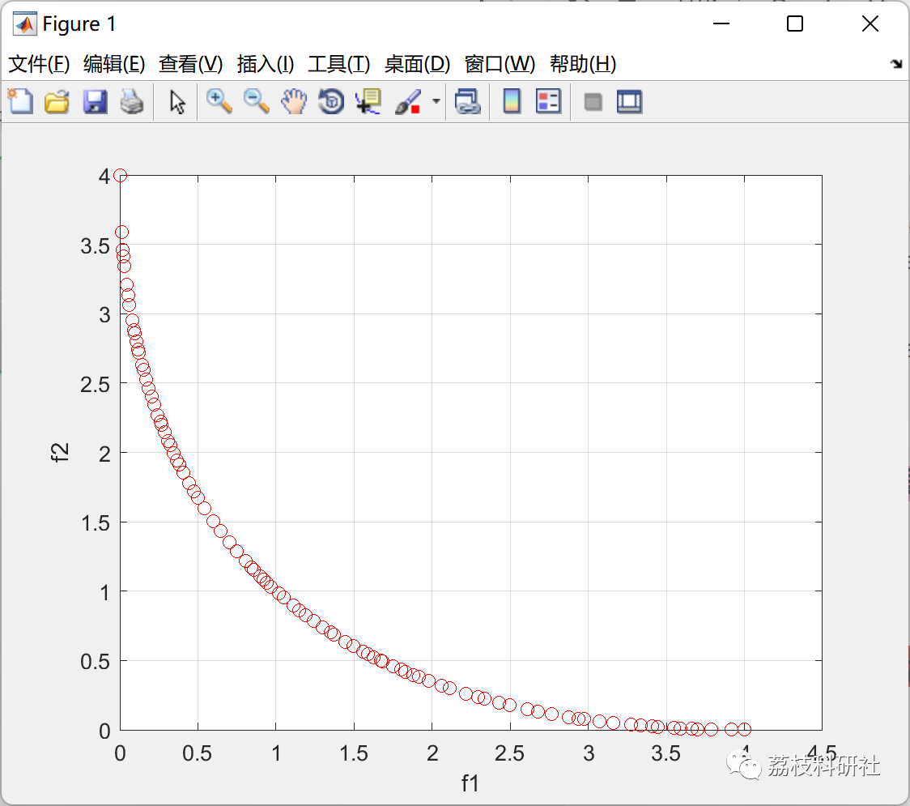

# Multi-Object Jellyfish Search (MOJS) Algorithm (Matlab Implementation)

💥💥💥💞💞💞 Welcome to this blog❤️❤️❤️💥💥💥
🏆 Bloggers' Advantages: 🌞🌞🌞 The content of the blog strives for rigorous thinking and clear logic to facilitate readers.
⛳️ Mantra: A journey of a thousand miles is begun with a single step.
Litchi Research Society
Code Collection: Power Systems, Intelligent Algorithms and Applications, Neural Network Prediction, Path Planning, Optimal Scheduling, Workshop Scheduling, Image Processing, Signal Processing...
🎁 Special Section Links:
🌈🌈🌈🌟🌟🌟 Electrical Code Intelligent Algorithms and Their Applications Path Planning Neural Network Prediction Optimal Scheduling Image Processing Workshop Scheduling Signal Processing Romantic Her Thoughts Math Modeling Complete Code Issues
💥1 Overview
This study developed a Multi-Objective Jellyfish Search (MOJS) algorithm to optimally solve engineering problems with multiple objectives. By integrating Lévy flight, elite population, fixed-size archive, chaotic maps, and the day-based jump method into MOJS, Pareto optimal solutions are obtained. These techniques are used to define the movement of sea anemones in ocean currents or the group search space for multi-objective searches.
Detailed article:
Chou, Jui-Sheng, and Dinh-Nhat Truong. "Multiobjective Optimization Inspired by Behavior of Jellyfish for Solving Structural Design Problems." Chaos, Solitons & Fractals, vol. 135, Elsevier BV, June 2020, p. 109738, doi:10.1016/j.chaos.2020.109738.
📚2 Run Results
🎉3 References
[1]Chou, Jui-Sheng, and Dinh-Nhat Truong. "Multiobjective Optimization Inspired by Behavior of Jellyfish for Solving Structural Design Problems." Chaos, Solitons & Fractals, vol. 135, Elsevier BV, June 2020, p. 109738, doi:10.1016/j.chaos.2020.109738.  
🌈4 Matlab code implementation

## Images

<!-- PAYMENT_BLOCK -->

## Get this dataset

- Payment link (Stripe): [Buy now](https://buy.stripe.com/3cs8yP7sY87d0vu9AB)
- Payment QR code: 

<!-- /PAYMENT_BLOCK -->
